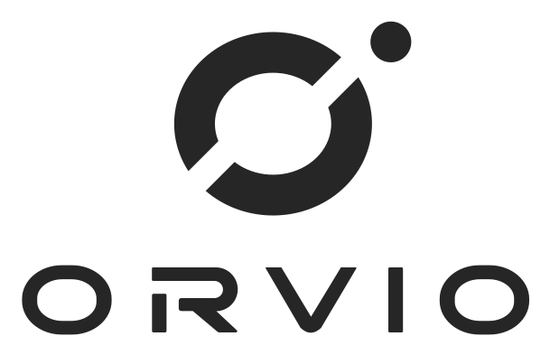
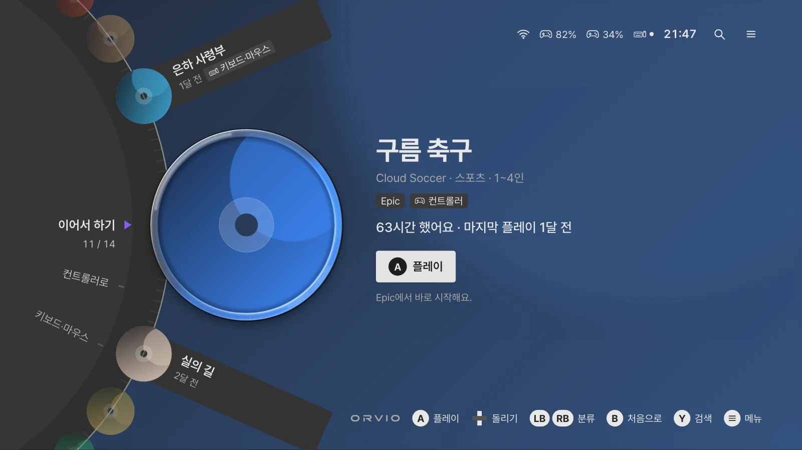

<p align="center">
  <picture>
    <source media="(prefers-color-scheme: dark)" srcset="brand/orvio-logo-dark.svg">
    
  </picture>
</p>

<p align="center"><b>거실 TV에 연결한 윈도우 게임 PC를 콘솔처럼 쓰게 해 주는 컨트롤러용 홈 화면</b></p>



> 위 화면의 게임 이름과 표지는 예시입니다. 실제로는 내 PC에 설치된 게임이 나옵니다.

PC를 켜면 ORVIO가 먼저 뜹니다. 원판을 돌려 게임을 고르고 A로 실행합니다. 게임을 끄면 다시 홈으로 돌아옵니다.

ORVIO는 [Playnite](https://playnite.link) 확장입니다. Playnite가 게임 목록·실행·플레이 시간을 맡고, ORVIO는 그 위에 전체화면 홈을 그립니다. 그래서 Xbox 앱, Steam, EA 앱, Ubisoft Connect처럼 Playnite에 연결한 런처의 게임이 한곳에 모입니다.

## 주요 기능

| 기능 | 내용 |
|---|---|
| 컨트롤러만으로 조작 | 게임 고르기, 실행, 분류, 검색, 볼륨, 전원까지 컨트롤러로 합니다. |
| CD 원판 | 원판을 돌리면 3시 방향의 CD가 빠져나옵니다. 표지가 구르다 멈추고 효과음이 납니다. |
| 게임에 맞춘 배경 | 고른 게임의 표지를 흐리게 깔아 줍니다. 라이트·다크·시간에 따라 자동을 고를 수 있습니다. |
| 웹도 컨트롤러로 | 유튜브 같은 사이트를 Edge 전체화면으로 엽니다. 왼쪽 스틱이 마우스가 되고, 창을 닫으면 홈으로 돌아옵니다. |
| 키보드·마우스 게임 안내 | 키보드와 마우스가 필요한 게임은 실행 전에 연결 상태를 알려 줍니다. |
| 한글 초성 검색 | `ㅇㄹ`처럼 초성만 넣어도 찾습니다. |
| 빠른 메뉴 | 테마, 볼륨, 화면 끄기, 절전, 바탕화면으로, 다시 시작, 시스템 종료 |

## 조작법

| 동작 | 컨트롤러 | 키보드 |
|---|---|---|
| 원판 돌리기 | 십자키 ↑↓ · 왼쪽 스틱 | ↑ ↓ |
| 실행·확인 | A | Enter |
| 뒤로·첫 항목으로 | B | Esc |
| 분류 바꾸기 | LB · RB | Q · E |
| 분류 링·상세 버튼으로 | ← · → | ← · → |
| 검색 | Y | / |
| 빠른 메뉴 | Menu | M |
| **숨어 있는 홈 다시 부르기** | **Menu 1초 길게** | 바탕화면 바로가기 |

웹을 보는 동안에는 왼쪽 스틱이 커서, A가 클릭, 오른쪽 스틱이 스크롤, Y가 화면 키보드, B가 뒤로 가기, LB·RB가 탭 이동입니다.

## 설치

**[INSTALL.md](INSTALL.md)** 를 따라 하면 됩니다. Playnite를 설치하고, ORVIO를 빌드해 붙인 뒤, Playnite와 윈도우 설정을 맞춥니다.

> [!IMPORTANT]
> 원판이 돌지 않고 순간이동하듯 바뀌면 윈도우의 `애니메이션 효과`가 꺼져 있는 것입니다. [켜는 법](INSTALL.md#애니메이션-켜기)을 확인하세요.

작성자는 Windows 11, Playnite 10.63, 4K TV(QHD 출력), Xbox 컨트롤러와 8BitDo Ultimate 2 환경에서 확인했습니다.

## 게임 표지와 효과음

저장소에는 게임 표지나 효과음이 들어 있지 않습니다.

- **표지:** 내 PC의 Playnite 라이브러리에 있는 표지를 읽습니다. 게임을 설치하면 나타나고, 지우면 사라집니다.
- **효과음:** PC에 설치된 Playnite 기본 전체화면 테마의 소리를 재생합니다. 파일이 없으면 소리 없이 동작합니다.

## 개발

화면은 맥이나 리눅스 브라우저에서도 볼 수 있습니다. Playnite 대신 가짜 데이터를 돌려주는 시험 모드로 뜹니다.

```bash
node tools/serve.mjs "$PWD/web" 8765
# 브라우저에서 http://127.0.0.1:8765/index.html 을 엽니다
```

| 할 일 | 명령 |
|---|---|
| 확장 로직 검사 | `dotnet run --project extension/Orvio.Checks -c Release` |
| 화면 로직 검사 | `node web/test/logic.test.mjs` |
| 설치 파일 만들기 | `extension/pack.sh` → `extension/dist/Orvio.pext` |
| 실제 입력 시험 | `node --experimental-websocket tools/cdp.mjs <주소> web/test/cdp/steps-main.json <결과 폴더>` (macOS의 Chrome 사용) |

필요한 도구는 .NET 10 SDK와 Node.js 20 이상입니다.

| 폴더 | 내용 |
|---|---|
| `web/` | 홈 화면(HTML·JS·글꼴). `web/test/`는 시험 모드 |
| `extension/` | Playnite 확장(C#, .NET Framework 4.6.2)과 검사 프로그램 |
| `brand/` | 로고와 아이콘 |
| `docs/` | 화면과 확장 사이의 메시지 약속, README 화면 |
| `tools/` | 시험용 정적 서버, 실제 입력 시험 도구 |

화면과 확장이 주고받는 메시지는 [docs/bridge-protocol.md](docs/bridge-protocol.md)에 있습니다.

## 저작권과 라이선스

아직 오픈소스 라이선스를 정하지 않았습니다.

ORVIO는 Playnite, Microsoft, Valve 또는 어떤 게임사와도 관련이 없는 개인 프로젝트입니다. Xbox, Steam 등의 이름과 시험 데이터의 게임 이름은 각 소유자의 상표입니다.

| 함께 쓰는 것 | 라이선스 |
|---|---|
| [Pretendard](https://github.com/orioncactus/pretendard) 글꼴 | SIL Open Font License 1.1 ([전문](web/fonts/LICENSE.txt)) |
| [Playnite SDK](https://github.com/JosefNemec/Playnite) | MIT |
| [Microsoft.Web.WebView2](https://www.nuget.org/packages/Microsoft.Web.WebView2) | Microsoft BSD 스타일 라이선스 |
